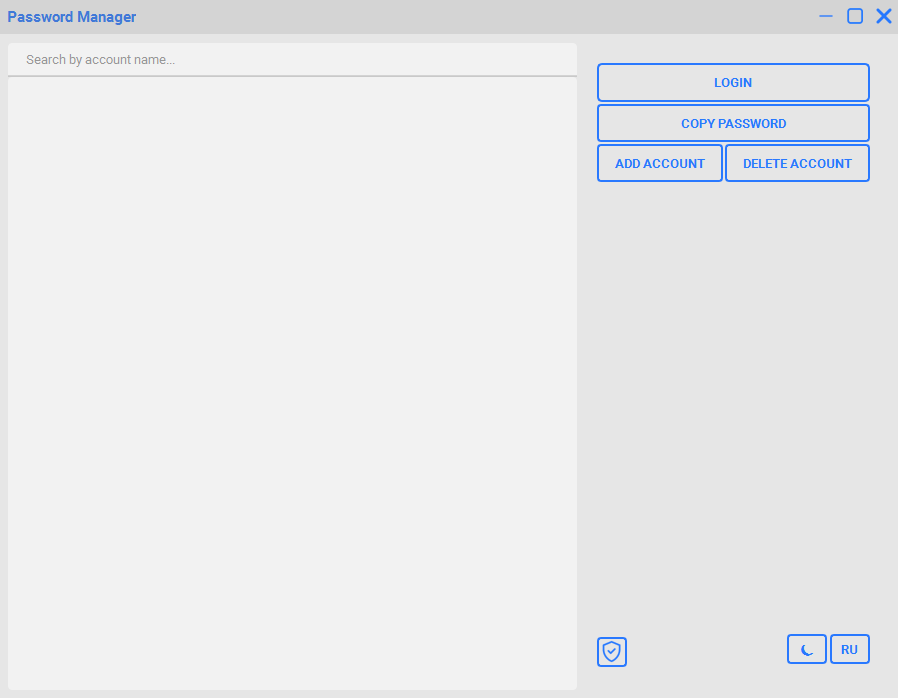
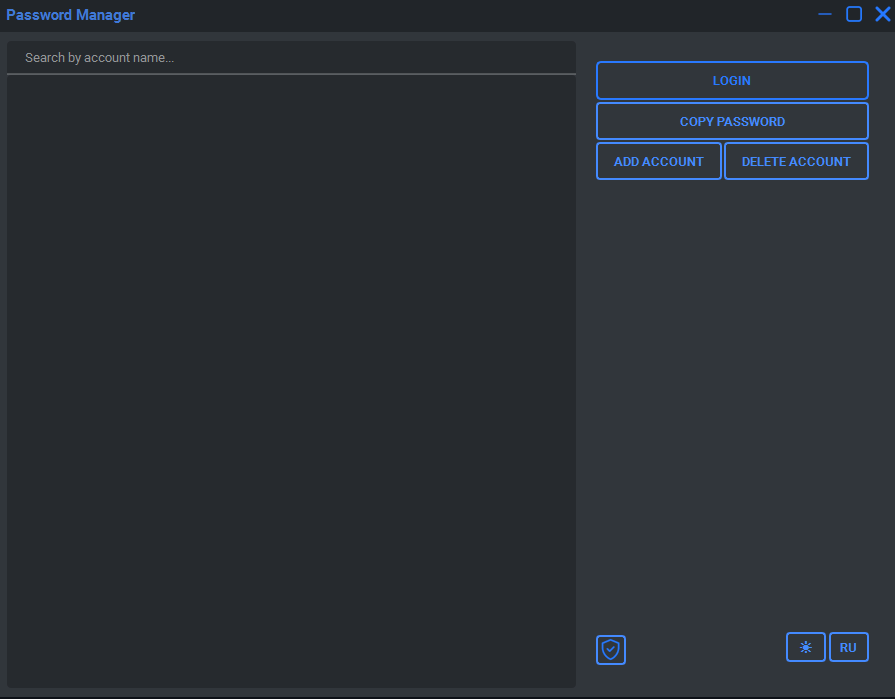

# Password Manager

Password Manager is an application for storing logins and passwords for various accounts locally.

## Features

- Adding and deleting accounts
- Viewing saved logins
- Copying passwords to the clipboard
- Automatic password generation
- Searching accounts by name
- Changing the master password
- Light and dark themes
- Russian and English language support

## Screenshots




## Installation

### Ready-made build (Windows)

1. Download the latest version from the [Releases](../../releases) page.
2. Unpack it and run the executable.

### From source

1. Install Python 3.14 or 3.15 (the project was developed on 3.14.2 and tested on 3.15.2).
2. Clone the repository:
   ```bash
   git clone https://github.com/NoirenXX/Password-Manager.git
   cd Password-Manager
   ```
3. Install dependencies:
   ```bash
   pip install PyQt6 argon2-cffi cryptography qt-material
   ```
4. Run the application:
   ```bash
   python PasswordManager.py
   ```

## Data Storage and Security

All logins and passwords are stored locally on your computer in an encrypted file named `setract`. This file is automatically created in the program's folder on the first launch.

- The encryption key is derived from your master password using **Argon2id**.
- The data is encrypted with **Fernet** (AES-based authenticated encryption).
- The master password itself is not stored anywhere.

A master password is required to access your saved data. **If you lose your master password, recovering access to your saved data will be impossible.**

> This is a personal project and has not undergone a professional security audit. Use it at your own risk.

## Important Precautions

- Do not delete or lose the `setract` file — it contains all your saved accounts.
- Do not move or rename the `setract` file. Keep it in the program's folder.
- Regularly create backup copies of the `setract` file and store them in another safe location.
- When moving the program to another computer, copy the `setract` file along with the program. Otherwise, your saved data will not be transferred.
- A backup copy will allow you to restore your data if the original file is lost or transfer it to another computer.

> **Remember:** you need both the `setract` file and your master password to access your saved data.

## License

This project is licensed under the MIT License. See the [LICENSE](LICENSE) file for details.
